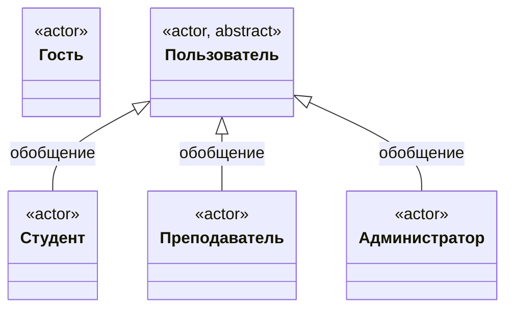
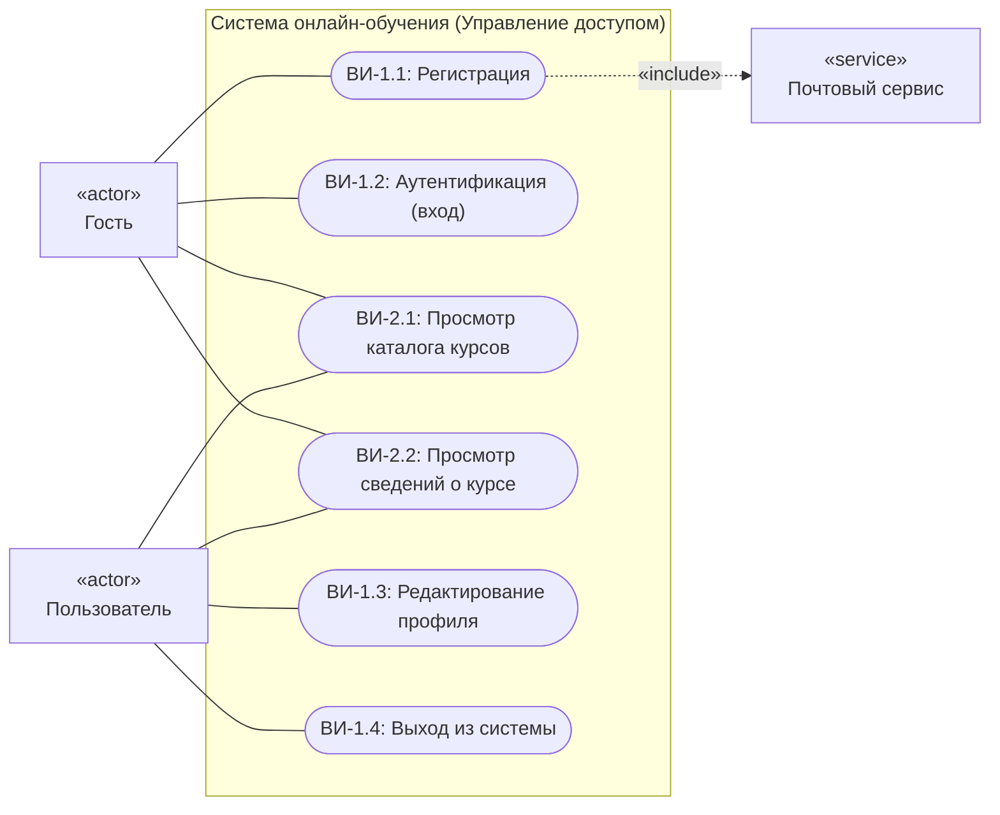
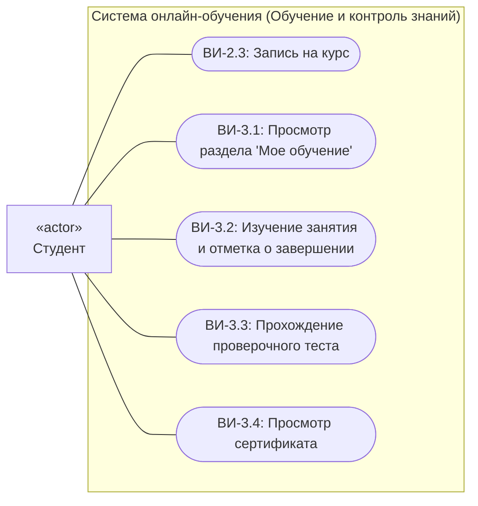
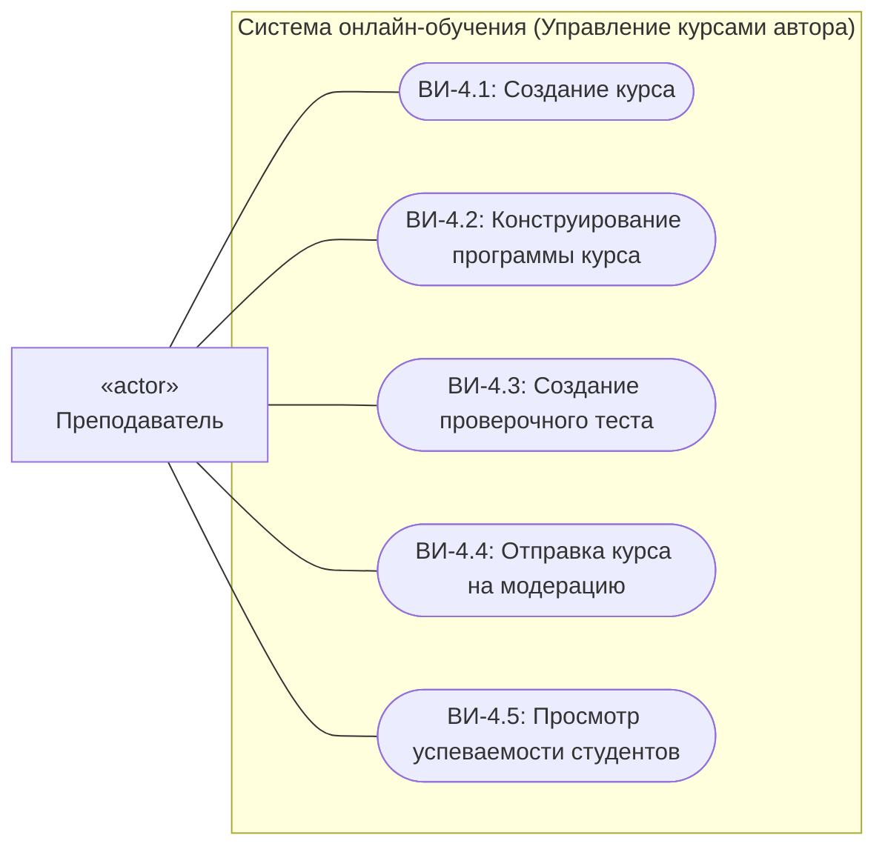
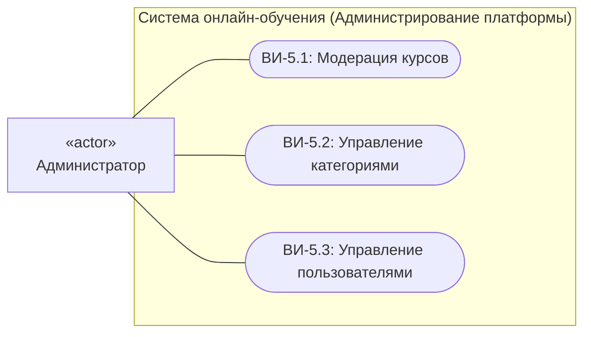

# Варианты использования

## 1. Введение
Настоящий документ определяет состав, границы и спецификации вариантов использования веб-приложения для организации онлайн-обучения и тестирования.

---

## 2. Акторы системы

В соответствии с ролевой моделью и состояниями сессии в системе выделяются следующие акторы:

- **Гость**: Неавторизованный посетитель веб-приложения. До момента прохождения аутентификации система взаимодействует с пользователем в роли Гостя (доступны регистрация, вход и просмотр открытого каталога курсов).
- **Пользователь**: Базовый абстрактный авторизованный актор, обладающий общесистемными действиями (редактирование профиля, выход из системы).
- **Студент**: Авторизованный актор обучения (наследует права Пользователя), осуществляющий запись на курсы, изучение материалов занятий, сдачу проверочных тестов и получение сертификатов.
- **Преподаватель**: Авторизованный актор-автор (наследует права Пользователя), создающий курсы, наполняющий учебные материалы и тесты и контролирующий успеваемость студентов.
- **Администратор**: Авторизованный актор управления платформой (наследует права Пользователя), осуществляющий модерацию курсов, ведение категорий каталога и блокировку нарушителей.
- **Почтовый сервис**: Внешняя обеспечивающая система (вторичный актор), привлекаемая для отправки сервисных сообщений с ссылками активации при регистрации.

### 2.1. Иерархия обобщения акторов

---

## 3. Диаграммы вариантов использования

### 3.1. Прецеденты актора «Гость» и базового актора «Пользователь»

### 3.2. Прецеденты актора «Студент»

### 3.3. Прецеденты актора «Преподаватель»

### 3.4. Прецеденты актора «Администратор»

---

## 4. Спецификация вариантов использования

### 4.1. Группа «Учетные записи и доступ»

| ID | Название | Актор | Предусловие | Описание | Постусловие |
| :--- | :--- | :--- | :--- | :--- | :--- |
| **ВИ-1.1** | Регистрация | Гость, Почтовый сервис | Пользователь не зарегистрирован | Ввод имени, email, пароля, выбор роли; валидация данных | Создана неактивная учётная запись, отправлено письмо со ссылкой активации |
| **ВИ-1.2** | Аутентификация | Гость | Учётная запись активна | Ввод email и пароля, проверка учётных данных | Создана сессия, активирована целевая роль пользователя |
| **ВИ-1.3** | Редактирование профиля | Пользователь | Пользователь успешно аутентифицирован | Изменение контактных данных или смена пароля в профиле | Персональные данные пользователя обновлены |
| **ВИ-1.4** | Выход из системы | Пользователь | Пользователь успешно аутентифицирован | Завершение текущей пользовательской сессии | Сессия аннулирована, контекст переведён в роль Гостя |

### 4.2. Группа «Каталог курсов и зачисление»

| ID | Название | Актор | Предусловие | Описание | Постусловие |
| :--- | :--- | :--- | :--- | :--- | :--- |
| **ВИ-2.1** | Поиск и просмотр каталога | Гость, Студент | Нет | Поиск по названию, фильтрация по категориям и сложности | Сформирован и отображён перечень опубликованных курсов |
| **ВИ-2.2** | Просмотр сведений о курсе | Гость, Студент | Курс находится в статусе «опубликован» | Просмотр аннотации, автора и структуры программы курса | Отображена страница курса с программой модулей |
| **ВИ-2.3** | Запись на курс | Студент | Студент авторизован, курс опубликован | Выбор команды зачисления на странице курса | Создана сущность «Запись на курс» со статусом «активна» и прогрессом 0% |

### 4.3. Группа «Обучение и контроль знаний»

| ID | Название | Актор | Предусловие | Описание | Постусловие |
| :--- | :--- | :--- | :--- | :--- | :--- |
| **ВИ-3.1** | Просмотр раздела «Мое обучение» | Студент | Студент успешно аутентифицирован | Открытие личного дашборда со списком курсов | Отображены курсы студента с процентами освоения |
| **ВИ-3.2** | Изучение занятия и отметка о завершении | Студент | Студент зачислен на курс | Изучение материалов занятия и подтверждение завершения | Создана отметка «Прохождение занятия», пересчитан общий прогресс записи на курс |
| **ВИ-3.3** | Прохождение проверочного теста | Студент | Открыт доступ к тесту модуля в рамках записи | Выполнение заданий в рамках лимита времени и отправка ответов | В рамках записи создана «Попытка тестирования» с итоговым баллом и статусом |
| **ВИ-3.4** | Просмотр сертификата | Студент | Прогресс по записи на курс достиг 100% | Запрос электронного свидетельства об окончании | Отображён сертификат с уникальным номером |

### 4.4. Группа «Управление курсами автора (Преподаватель)»

| ID | Название | Актор | Предусловие | Описание | Постусловие |
| :--- | :--- | :--- | :--- | :--- | :--- |
| **ВИ-4.1** | Создание курса | Преподаватель | Роль «Преподаватель» | Ввод названия, описания, выбор категории и уровня сложности | Создан курс с привязкой автора в статусе «черновик» |
| **ВИ-4.2** | Конструирование программы | Преподаватель | Автор курса, курс в статусе «черновик» | Добавление модулей и наполнение занятий материалами | Структура модулей и занятий сохранена в курсе |
| **ВИ-4.3** | Создание проверочного теста | Преподаватель | Модуль создан | Настройка проходного балла, лимита времени и банка вопросов | Тест с вопросами и вариантами ответов привязан к модулю |
| **ВИ-4.4** | Отправка курса на модерацию | Преподаватель | Курс укомплектован (есть модули, занятия, тесты) | Направление курса на административную проверку | Статус курса изменён на «на модерации» |
| **ВИ-4.5** | Просмотр успеваемости студентов | Преподаватель | На курсы преподавателя есть зачисленные студенты | Открытие раздела «Успеваемость» по выбранному курсу | Отображена сводная ведомость прогресса и оценок студентов |

### 4.5. Группа «Администрирование платформы»

| ID | Название | Актор | Предусловие | Описание | Постусловие |
| :--- | :--- | :--- | :--- | :--- | :--- |
| **ВИ-5.1** | Модерация курсов | Администратор | Курс находится в статусе «на модерации» | Проверка содержания курса и принятие решения (одобрить/отклонить) | Статус курса изменён на «опубликован» либо возвращён в «черновик» с замечаниями |
| **ВИ-5.2** | Управление категориями | Администратор | Роль «Администратор» | Добавление, редактирование или удаление тематических рубрик | Каталог категорий обновлён |
| **ВИ-5.3** | Управление пользователями | Администратор | Роль «Администратор» | Просмотр реестра аккаунтов, блокировка/разблокировка пользователей | Статус учётной записи пользователя обновлён |
