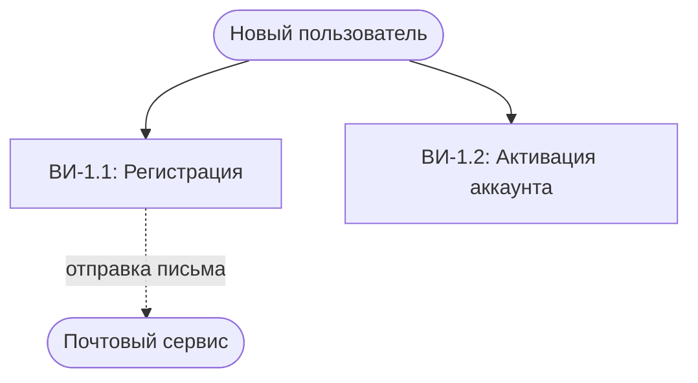
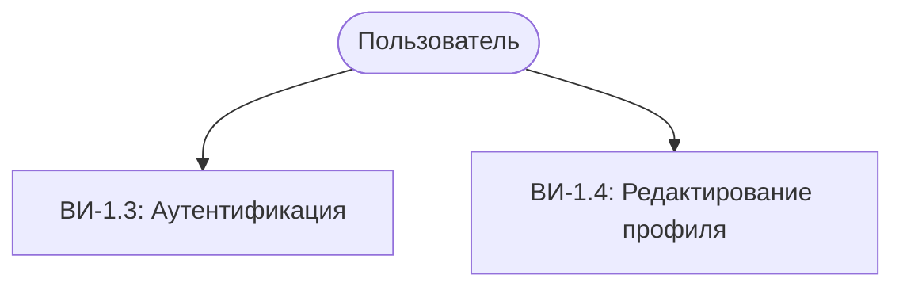
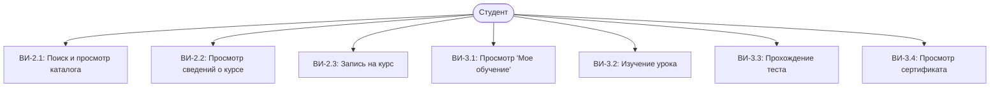
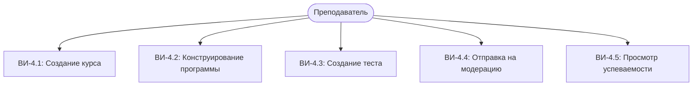
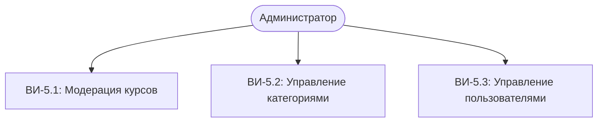

# Варианты использования

## 1. Введение
Настоящий документ определяет состав и границы вариантов использования (Use Cases) веб-приложения для организации онлайн-обучения и тестирования. Диаграмма и спецификации вариантов использования фиксируют функциональные требования к системе через взаимодействие внешних акторов с функциональными модулями платформы.

## 2. Акторы системы
- **Новый пользователь**: Актор, проходящий регистрацию и активацию аккаунта.
- **Пользователь**: Зарегистрированный актор, прошедший процедуру входа (базовый профиль).
- **Студент**: Основной актор обучения, проходящий курсы и тесты.
- **Преподаватель**: Актор, создающий и публикующий обучающие курсы и контролирующий успеваемость.
- **Администратор**: Актор, выполняющий модерацию курсов и управление системой.
- **Почтовый сервис**: Внешняя система, обеспечивающая доставку служебных писем (активация аккаунта).

## 3. Диаграмма вариантов использования

### Новый пользователь

### Пользователь (общие функции)

### Студент

### Преподаватель

### Администратор

> **Примечание**: Студент, Преподаватель и Администратор наследуют общие функции Пользователя (ВИ-1.3, ВИ-1.4).

## 4. Спецификация вариантов использования

### 4.1. Группа «Учетные записи и профиль»

| ID | Название | Актор | Предусловие | Описание | Постусловие |
| :--- | :--- | :--- | :--- | :--- | :--- |
| **ВИ-1.1** | Регистрация | Новый пользователь | Пользователь не зарегистрирован | Ввод имени, email, пароля и выбор роли | В БД создана неактивная запись, отправлено письмо |
| **ВИ-1.2** | Активация аккаунта | Новый пользователь | Получено письмо с токеном | Переход по ссылке активации из письма | Статус аккаунта изменен на «Активна» |
| **ВИ-1.3** | Аутентификация | Пользователь | Аккаунт активен | Ввод email и пароля | Создана сессия, выполнен вход в систему |
| **ВИ-1.4** | Редактирование профиля | Пользователь | Выполнен вход в систему | Изменение имени или пароля в разделе «Профиль» | Данные профиля обновлены в БД |

### 4.2. Группа «Каталог курсов и запись»

| ID | Название | Актор | Предусловие | Описание | Постусловие |
| :--- | :--- | :--- | :--- | :--- | :--- |
| **ВИ-2.1** | Поиск и просмотр каталога | Студент, Гость | Нет | Фильтрация по категориям, сложности и поиск | Отображен список подходящих курсов |
| **ВИ-2.2** | Просмотр сведений о курсе | Студент, Гость | Курс опубликован | Открытие страницы курса с описанием и программой | Отображена подробная информация о курсе |
| **ВИ-2.3** | Запись на курс | Студент | Студент авторизован | Нажатие кнопки «Записаться на курс» | Создана запись зачисления со статусом `in_progress` |

### 4.3. Группа «Обучение и контроль знаний»

| ID | Название | Актор | Предусловие | Описание | Постусловие |
| :--- | :--- | :--- | :--- | :--- | :--- |
| **ВИ-3.1** | Просмотр раздела «Мое обучение» | Студент | Студент авторизован | Открытие личного дашборда с курсами | Отображен список курсов со шкалами прогресса |
| **ВИ-3.2** | Изучение урока и отметка о завершении | Студент | Студент записан на курс | Просмотр контента и нажатие «Завершить урок» | Урок зафиксирован как пройденный, обновлен прогресс |
| **ВИ-3.3** | Прохождение проверочного теста | Студент | Открыт доступ к тесту | Ответы на вопросы в рамках таймера и отправка | Балл рассчитан, статус теста и прогресс обновлены |
| **ВИ-3.4** | Просмотр сертификата | Студент | Прогресс по курсу 100% | Переход к просмотру выданного сертификата | Отображен электронный сертификат с номером |

### 4.4. Группа «Управление курсами (Преподаватель)»

| ID | Название | Актор | Предусловие | Описание | Постусловие |
| :--- | :--- | :--- | :--- | :--- | :--- |
| **ВИ-4.1** | Создание курса | Преподаватель | Роль «Преподаватель» | Ввод названия, описания, категории и сложности | Создан курс со статусом `draft` |
| **ВИ-4.2** | Конструирование программы | Преподаватель | Курс в статусе `draft` | Добавление модулей и наполнение уроков материалами | Структура и контент сохранены в БД |
| **ВИ-4.3** | Создание проверочного теста | Преподаватель | Модуль создан | Настройка проходного балла, лимита времени и вопросов | Тест и вопросы сохранены в БД |
| **ВИ-4.4** | Отправка курса на модерацию | Преподаватель | Курс заполнен | Нажатие кнопки «Отправить на модерацию» | Статус курса изменен на `pending_review` |
| **ВИ-4.5** | Просмотр успеваемости студентов | Преподаватель | Есть записавшиеся студенты | Открытие раздела «Успеваемость» по своему курсу | Отображена таблица прогресса и оценок студентов |

### 4.5. Группа «Модерация и администрирование»

| ID | Название | Актор | Предусловие | Описание | Постусловие |
| :--- | :--- | :--- | :--- | :--- | :--- |
| **ВИ-5.1** | Модерация курсов | Администратор | Курс в статусе `pending_review` | Проверка содержания и принятие решения (одобрить/отклонить) | Статус курса изменен на `published` либо `draft` |
| **ВИ-5.2** | Управление категориями | Администратор | Роль «Администратор» | Добавление, переименование или удаление категории | Список категорий каталога обновлен в БД |
| **ВИ-5.3** | Управление пользователями | Администратор | Роль «Администратор» | Просмотр списка пользователей и блокировка нарушителей | Статус пользователя изменен в БД |
