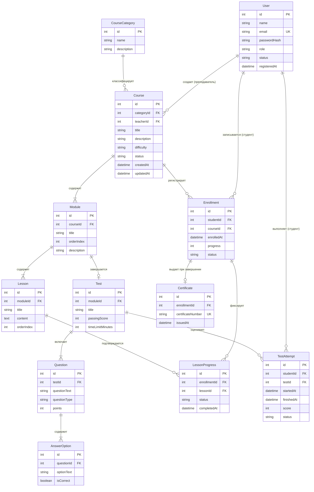

# Модель предметной области

## 1. Введение
Модель предметной области (Domain Model) описывает ключевые концептуальные сущности веб-приложения для организации онлайн-обучения и тестирования, их атрибуты, связи и кратности. Модель служит фундаментом для последующего проектирования реляционной базы данных и программных компонентов системы.

## 2. Диаграмма классов предметной области

> **Примечание к наследованию ролей**: Пользователь (User) имеет атрибут `role`, принимающий значения `student`, `teacher` или `admin`. Студент, Преподаватель и Администратор различаются значением этого поля и набором доступных функций.

## 3. Описание сущностей

### 3.1. Пользователь (User)
Базовый класс учетной записи в системе.
- **id**: Уникальный идентификатор учетной записи.
- **имя**: Отображаемое имя или ФИО пользователя.
- **email**: Уникальный адрес электронной почты (используется как логин).
- **хешПароля**: Криптографический хеш пароля (bcrypt/argon2).
- **роль**: Роль в системе (`student`, `teacher`, `admin`).
- **статус**: Текущее состояние аккаунта (`inactive`, `active`).
- **датаРегистрации**: Временная метка создания учетной записи.

### 3.2. Специализации пользователя
- **Студент**: Обучающийся, проходящий программы курсов и контрольные испытания.
- **Преподаватель**: Автор образовательных курсов, формирующий учебные программы и тесты.
- **Администратор**: Системный модератор, одобряющий публикацию курсов и управляющий каталогом.

### 3.3. КатегорияКурса (CourseCategory)
Тематическая рубрика каталога.
- **id**: Уникальный идентификатор категории.
- **название**: Наименование раздела (например, «Веб-разработка», «Базы данных»).
- **описание**: Текстовое пояснение специфики раздела.

### 3.4. Курс (Course)
Основная структурная единица образовательного процесса.
- **id**: Уникальный идентификатор курса.
- **название**: Полное наименование программы курса.
- **описание**: Развернутая аннотация и цели изучения.
- **уровеньСложности**: Уровень подготовки слушателей (`beginner`, `intermediate`, `advanced`).
- **статус**: Состояние жизненного цикла курса (`draft`, `pending_review`, `published`).
- **датаСоздания**: Временная метка первоначального сохранения.
- **датаОбновления**: Временная метка последнего изменения.

### 3.5. Модуль (CourseModule)
Тематический раздел внутри курса.
- **id**: Уникальный идентификатор модуля.
- **название**: Заголовок модуля.
- **порядковыйНомер**: Порядковый индекс отображения в структуре курса.
- **описание**: Краткий обзор тем модуля.

### 3.6. Урок (Lesson)
Атомарная единица теоретического контента.
- **id**: Уникальный идентификатор урока.
- **название**: Заголовок урока.
- **контент**: Текстовое и медиасодержимое урока (разметка Markdown, ссылки).
- **порядковыйНомер**: Позиция урока в рамках модуля.

### 3.7. Тест (Test)
Инструмент рубежного контроля знаний модуля.
- **id**: Уникальный идентификатор теста.
- **название**: Наименование проверочной работы.
- **проходнойБалл**: Минимальный процент правильных ответов для зачета (например, 75%).
- **лимитВремениМинут**: Ограничение по времени на выполнение попытки в минутах.

### 3.8. Вопрос (Question)
Задание в рамках контрольного теста.
- **id**: Уникальный идентификатор вопроса.
- **текстВопроса**: Формулировка задания.
- **типВопроса**: Формат ответа (`single_choice`, `multiple_choice`, `text_input`).
- **баллы**: Весовой коэффициент вопроса при оценке.

### 3.9. ВариантОтвета (AnswerOption)
Вариант ответа к вопросу теста.
- **id**: Уникальный идентификатор варианта ответа.
- **текстОтвета**: Текст варианта.
- **являетсяПравильным**: Булев флаг корректности ответа.

### 3.10. ЗаписьНаКурс (Enrollment)
Факт зачисления студента на опубликованный курс.
- **id**: Уникальный идентификатор записи.
- **датаЗаписи**: Временная метка начала прохождения курса.
- **прогресс**: Текущий рассчитанный процент прохождения программы (0..100%).
- **статус**: Состояние обучения (`in_progress`, `completed`).

### 3.11. ПрохождениеУрока (LessonProgress)
Отметка об освоении конкретного урока студентом.
- **id**: Уникальный идентификатор записи.
- **статус**: Флаг прохождения (`completed`).
- **датаЗавершения**: Временная метка подтверждения изучения.

### 3.12. ПопыткаТестирования (TestAttempt)
Сеанс сдачи проверочного теста студентом.
- **id**: Уникальный идентификатор попытки.
- **времяНачала**: Метка времени старта попытки (для контроля таймера).
- **времяЗавершения**: Метка времени отправки ответов на проверку.
- **набранныйБалл**: Итоговый процент правильных ответов.
- **статус**: Результат сдачи (`passed`, `failed`).

### 3.13. Сертификат (Certificate)
Электронное свидетельство об успешном завершении обучения.
- **номерСертификата**: Уникальный буквенно-цифровой регистрационный номер.
- **датаВыдачи**: Дата достижения 100% прогресса по курсу.

## 4. Таблица связей и кратностей

| Связь | Тип связи | Кратность | Описание |
| :--- | :--- | :---: | :--- |
| **КатегорияКурса $\rightarrow$ Курс** | Ассоциация | `1` к `0..*` | Категория объединяет множество курсов |
| **Преподаватель $\rightarrow$ Курс** | Ассоциация | `1` к `0..*` | Преподаватель выступает автором курсов |
| **Курс $\rightarrow$ Модуль** | Композиция | `1` к `1..*` | Курс состоит из одного или нескольких модулей |
| **Модуль $\rightarrow$ Урок** | Композиция | `1` к `1..*` | Модуль содержит упорядоченные уроки |
| **Модуль $\rightarrow$ Тест** | Композиция | `1` к `0..1` | Модуль может завершаться контрольным тестом |
| **Тест $\rightarrow$ Вопрос** | Композиция | `1` к `1..*` | Тест включает в себя банк вопросов |
| **Вопрос $\rightarrow$ ВариантОтвета** | Композиция | `1` к `1..*` | Вопрос содержит варианты ответов |
| **Студент $\rightarrow$ ЗаписьНаКурс** | Ассоциация | `1` к `0..*` | Студент может записаться на множество курсов |
| **Курс $\rightarrow$ ЗаписьНаКурс** | Ассоциация | `1` к `0..*` | На курс могут записаться множество студентов |
| **ЗаписьНаКурс $\rightarrow$ ПрохождениеУрока** | Композиция | `1` к `0..*` | В рамках записи фиксируются пройденные уроки |
| **Студент $\rightarrow$ ПопыткаТестирования** | Ассоциация | `1` к `0..*` | Студент выполняет попытки сдачи тестов |
| **Тест $\rightarrow$ ПопыткаТестирования** | Ассоциация | `1` к `0..*` | Тест оценивает результаты попыток |
| **ЗаписьНаКурс $\rightarrow$ Сертификат** | Ассоциация | `1` к `0..1` | Успешно завершенная запись порождает сертификат |
