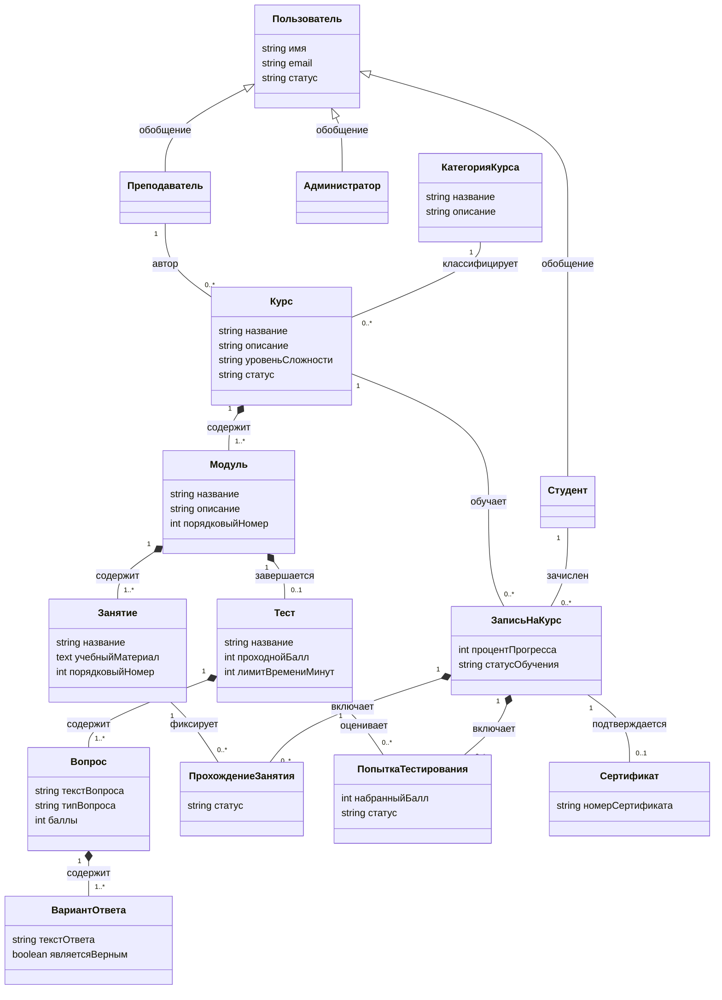

# Модель предметной области

## 1. Введение
Модель предметной области описывает ключевые бизнес-сущности образовательной платформы, их содержательные атрибуты, структурные связи и кратности.

---

## 2. Диаграмма классов предметной области

> **Архитектурные пояснения к модели:**
> 1. **Изоляция прав доступа**: В модели отсутствует связь между Администратором и Курсом, так как право модерации определяется ролью доступа и не формирует персистентной связи в данных.
> 2. **Сущность «Запись на курс»**: Студент и Курс связаны через сущность зачисления «Запись на курс».
> 3. **Локализация результатов тестирования**: Попытки тестирования и прохождение занятий фиксируются строго в рамках записи на курс, а не профиля пользователя.

---

## 3. Описание сущностей предметной области

### 3.1. Пользователь
Базовая сущность, представляющая зарегистрированного пользователя в системе.
- **имя**: Отображаемое имя (ФИО).
- **email**: Контактный адрес электронной почты.
- **статус**: Состояние учетной записи (активна, заблокирована).

### 3.2. Специализированные роли пользователя
- **Студент**: Пользователь, зачисляемый на курсы, изучающий материалы занятий и сдающий проверочные тесты.
- **Преподаватель**: Автор курсов, формирующий программу обучения и тесты и контролирующий успеваемость.
- **Администратор**: Системный модератор, ответственный за проверку курсов перед публикацией и ведение рубрикатора категорий.

### 3.3. Категория курса
Тематический раздел каталога для классификации и фильтрации программ обучения.
- **название**: Наименование раздела.
- **описание**: Аннотация тематического охвата категории.

### 3.4. Курс
Образовательная программа, разрабатываемая автором и доступная для прохождения студентами.
- **название**: Наименование курса.
- **описание**: Цели, программа и результаты обучения.
- **уровеньСложности**: Начальный, средний или продвинутый уровень подготовки.
- **статус**: Жизненный цикл курса (черновик, на модерации, опубликован).

### 3.5. Модуль
Раздел внутри курса, объединяющий логически связанную цепочку занятий и завершающийся контрольным тестом.
- **название**: Тема модуля.
- **описание**: Краткий план раздела.
- **порядковыйНомер**: Номер раздела в общей последовательности курса.

### 3.6. Занятие (Урок)
Атомарная единица теоретического или практического учебного материала.
- **название**: Тема занятия.
- **учебныйМатериал**: Содержательный контент занятия (текст, ссылки, иллюстрации).
- **порядковыйНомер**: Позиция занятия в рамках модуля.

### 3.7. Тест
Средство рубежного контроля усвоения знаний по итогам изучения модуля.
- **название**: Наименование проверочной работы.
- **проходнойБалл**: Минимальный процент верных ответов для зачёта (например, 70%).
- **лимитВремениМинут**: Ограничение по продолжительности одной попытки сдачи в минутах.

### 3.8. Вопрос
Контрольное задание в составе теста.
- **текстВопроса**: Формулировка вопроса или задачи.
- **типВопроса**: Формат ответа (одиночный выбор, множественный выбор).
- **баллы**: Весовой балл вопроса при подсчёте результата.

### 3.9. Вариант ответа
Вариант решения вопроса теста.
- **текстОтвета**: Текстовое описание варианта.
- **являетсяВерным**: Логический признак правильности варианта.

### 3.10. Запись на курс
Сущность процесса обучения, связывающая студента с курсом и аккумулирующая прогресс обучения.
- **процентПрогресса**: Текущая доля освоения курса (от 0 до 100%).
- **статусОбучения**: Состояние прохождения (активно, завершено, отчислено).

### 3.11. Прохождение занятия
Запись о факте освоения материала конкретного занятия студентом в рамках записи на курс.
- **статус**: Отметка освоения (не начато, завершено).

### 3.12. Попытка тестирования
Протокол сеанса сдачи проверочного теста в контексте записи на курс.
- **набранныйБалл**: Итоговый процент правильно решённых заданий.
- **статус**: Результат сдачи (в процессе, пройден, не пройден).

### 3.13. Сертификат
Документ, формируемый для студента при успешном окончании курса.
- **номерСертификата**: Уникальный регистрационный буквенно-цифровой идентификатор.

---

## 4. Таблица связей и кратностей модели

| Связь между сущностями | Тип связи | Кратность | Описание |
| :--- | :--- | :---: | :--- |
| **Пользователь $\leftarrow$ Студент** | Обобщение | — | Студент является частным случаем Пользователя |
| **Пользователь $\leftarrow$ Преподаватель** | Обобщение | — | Преподаватель является частным случаем Пользователя |
| **Пользователь $\leftarrow$ Администратор** | Обобщение | — | Администратор является частным случаем Пользователя |
| **Категория курса — Курс** | Ассоциация | `1` к `0..*` | Категория группирует множество курсов |
| **Преподаватель — Курс** | Ассоциация | `1` к `0..*` | Преподаватель выступает автором курсов |
| **Курс $\diamond$ Модуль** | Композиция | `1` к `1..*` | Курс неразрывно состоит из модулей |
| **Модуль $\diamond$ Занятие** | Композиция | `1` к `1..*` | Модуль неразрывно состоит из занятий |
| **Модуль $\diamond$ Тест** | Композиция | `1` к `0..1` | Модуль может содержать рубежный тест |
| **Тест $\diamond$ Вопрос** | Композиция | `1` к `1..*` | Тест включает контрольные вопросы |
| **Вопрос $\diamond$ Вариант ответа** | Композиция | `1` к `1..*` | Вопрос содержит варианты ответов |
| **Студент — Запись на курс** | Ассоциация | `1` к `0..*` | Студент имеет записи на различные курсы |
| **Курс — Запись на курс** | Ассоциация | `1` к `0..*` | На курс зачисляется множество обучающихся |
| **Запись на курс $\diamond$ Прохождение занятия** | Композиция | `1` к `0..*` | Запись аккумулирует отметки о пройденных занятиях |
| **Занятие — Прохождение занятия** | Ассоциация | `1` к `0..*` | Занятие фиксируется в протоколах зачислений |
| **Запись на курс $\diamond$ Попытка тестирования** | Композиция | `1` к `0..*` | Запись аккумулирует попытки сдачи тестов |
| **Тест — Попытка тестирования** | Ассоциация | `1` к `0..*` | Тест сопоставляется с протоколами попыток |
| **Запись на курс — Сертификат** | Ассоциация | `1` к `0..1` | Запись с 100% прогрессом порождает сертификат |
