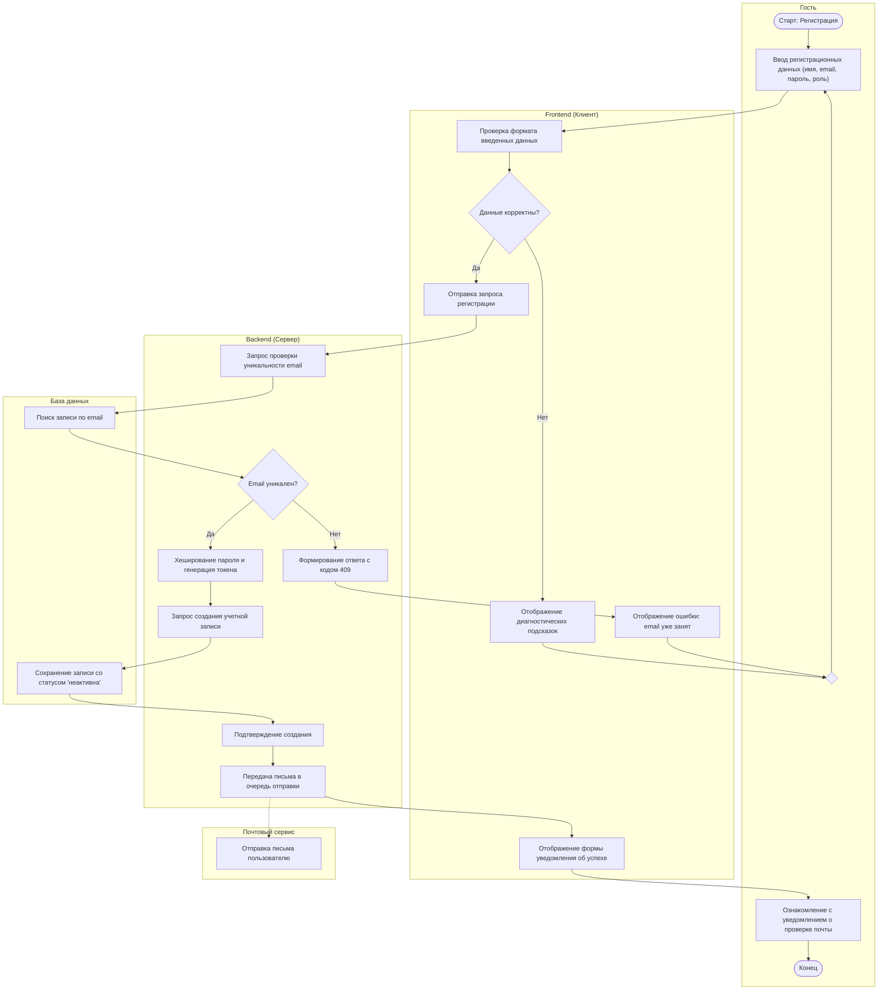
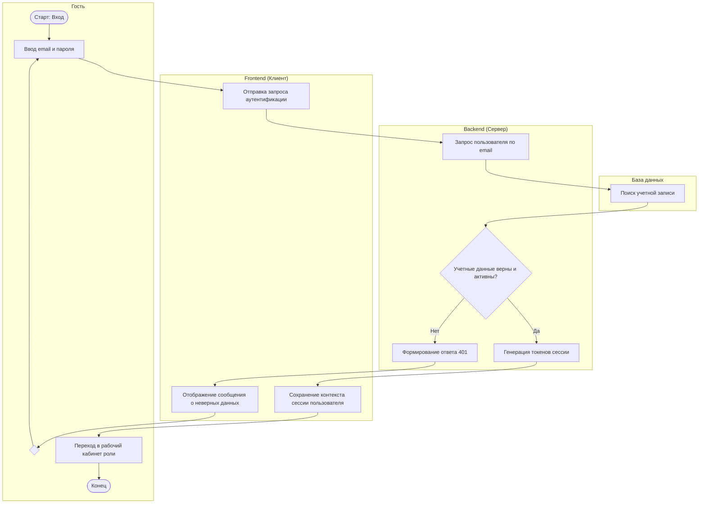
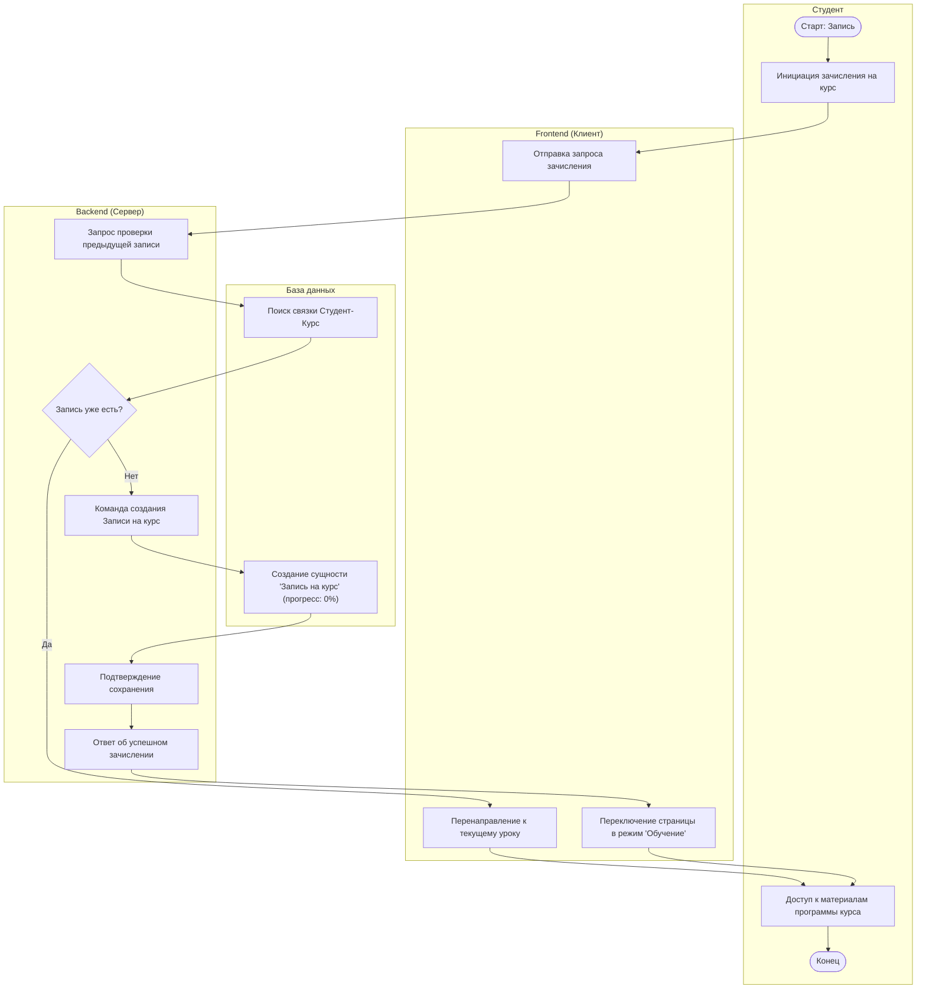
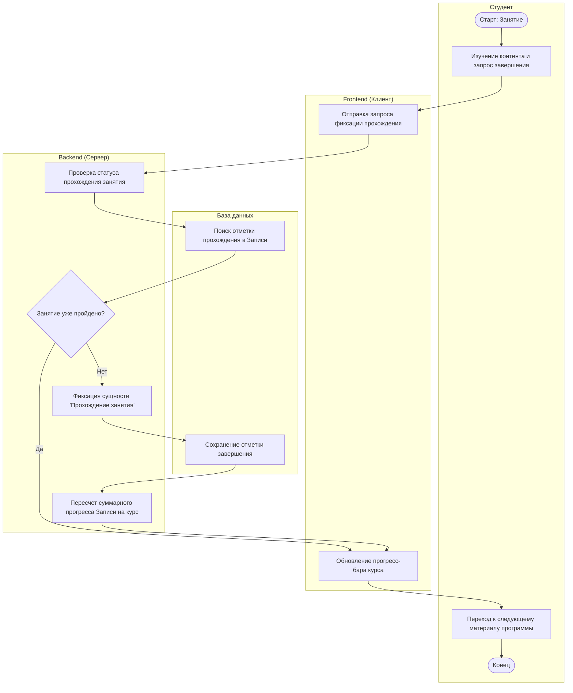
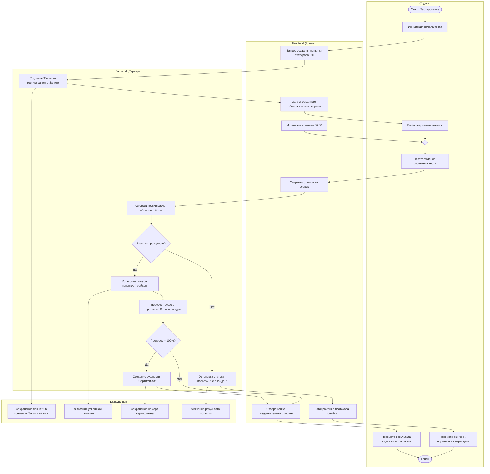
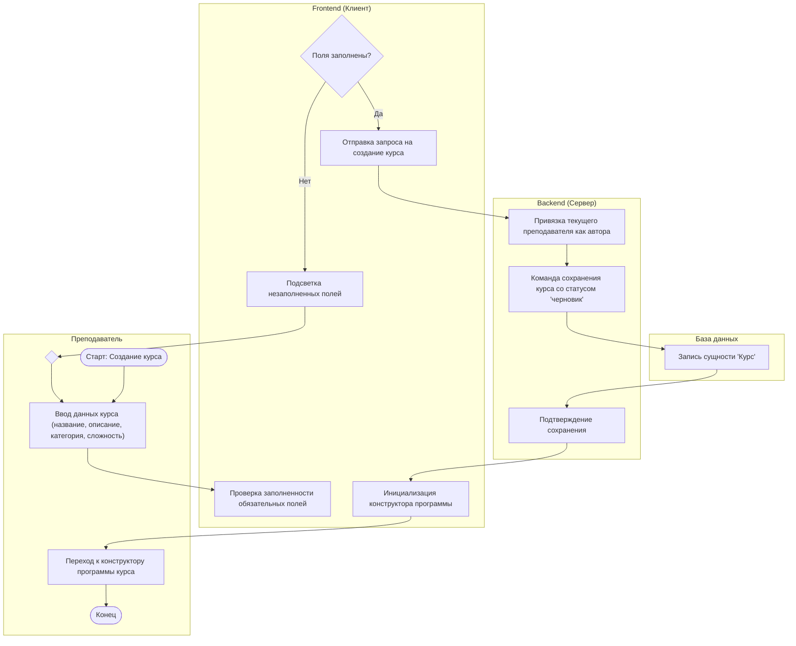
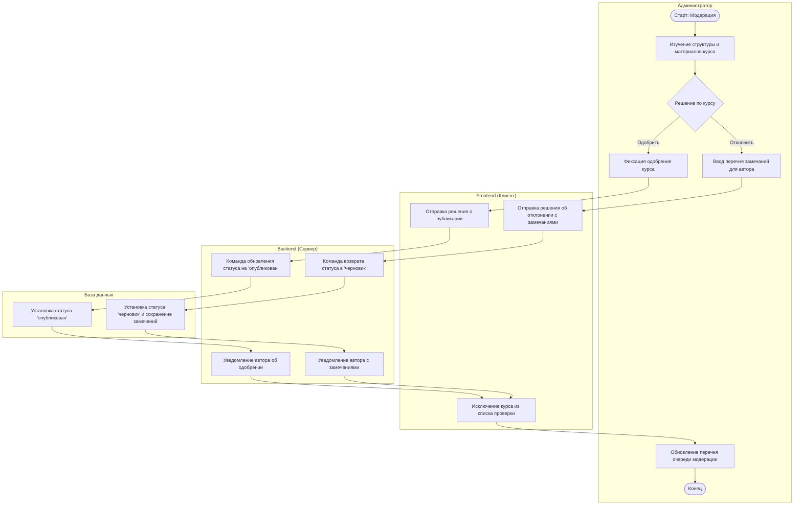

# Сценарии использования

## 1. Введение
Настоящий документ содержит спецификации и диаграммы деятельности для ключевых прецедентов веб-приложения для организации онлайн-обучения и тестирования.

---

## 2. Сценарий 1: Регистрация (ВИ-1.1)

### 2.1. Паспорт сценария
- **Вариант использования**: ВИ-1.1 (Регистрация).
- **Основной актор**: Гость.
- **Вторичный актор**: Почтовый сервис.
- **Предусловие**: Гость находится в форме регистрации.
- **Постусловие**: В БД сохранена учётная запись со статусом «неактивна», почтовому шлюзу передано задание на отправку письма с токеном активации.

### 2.2. Основной поток событий
1. Гость вводит регистрационные данные (имя, email, пароль, целевая роль).
2. Frontend выполняет первичную валидацию формата данных.
3. Frontend передает запрос на регистрацию на Backend.
4. Backend выполняет проверку уникальности email в Базе данных.
5. База данных подтверждает отсутствие учетной записи с данным email.
6. Backend выполняет криптографическое хеширование пароля и генерирует одноразовый токен активации.
7. Backend передает команду создания записи пользователя в Базу данных.
8. База данных сохраняет запись пользователя со статусом «неактивна».
9. Backend передает запрос Почтовому сервису на отправку сервисного письма со ссылкой активации.
10. Backend возвращает ответ об успешном приеме заявки.
11. Frontend информирует Гостя о необходимости подтверждения почты.

### 2.3. Альтернативные потоки событий
- **А1: Ошибка формата данных на клиенте (шаг 2)**
  1. Frontend фиксирует некорректный формат email или недостаточную длину пароля.
  2. Frontend выводит диагностические сообщения и ожидает исправления данных.
- **А2: Email уже зарегистрирован в системе (шаг 5)**
  1. База данных возвращает признак наличия записи с указанным email.
  2. Backend формирует ответ с кодом 409 (Конфликт).
  3. Frontend информирует Гостя о том, что учетная запись с данным адресом уже существует.

### 2.4. Диаграмма деятельности

---

## 3. Сценарий 2: Аутентификация (ВИ-1.2)

### 3.1. Паспорт сценария
- **Вариант использования**: ВИ-1.2 (Аутентификация).
- **Основной актор**: Гость.
- **Предусловие**: Учётная запись пользователя создана и активирована.
- **Постусловие**: Сформирована защищённая сессия, Гость переведён в статус авторизованного Пользователя с активацией специализированной роли.

### 3.2. Основной поток событий
1. Гость вводит email и пароль в форме входа.
2. Frontend направляет учетные данные на Backend.
3. Backend запрашивает запись пользователя по email из Базы данных.
4. База данных возвращает хэш пароля, статус аккаунта и роль.
5. Backend выполняет верификацию введенного пароля с хэшем и проверяет активность аккаунта.
6. Backend генерирует токены сессии (JWT) с правами роли.
7. Backend возвращает токены авторизации клиенту.
8. Frontend сохраняет контекст сессии и отображает стартовый интерфейс роли (`Студент`, `Преподаватель` или `Администратор`).

### 3.3. Альтернативные потоки событий
- **А1: Неверные учетные данные или неактивный аккаунт (шаг 5)**
  1. Backend фиксирует несовпадение хэша либо статус «неактивен».
  2. Backend возвращает ошибку 401 (Не авторизован).
  3. Frontend выводит предупреждение о неверных данных.

### 3.4. Диаграмма деятельности

---

## 4. Сценарий 3: Запись на курс (ВИ-2.3)

### 4.1. Паспорт сценария
- **Вариант использования**: ВИ-2.3 (Запись на курс).
- **Основной актор**: Студент.
- **Предусловие**: Студент успешно аутентифицирован, курс опубликован в каталоге.
- **Постусловие**: В БД создана сущность «Запись на курс» с прогрессом 0% и статусом «активно».

### 4.2. Основной поток событий
1. Студент инициирует команду зачисления на странице выбранного курса.
2. Frontend отправляет запрос на зачисление с идентификатором курса.
3. Backend проверяет в Базе данных отсутствие существующей записи студента на данный курс.
4. База данных подтверждает отсутствие активной записи.
5. Backend направляет команду создания сущности «Запись на курс».
6. База данных создает запись со статусом «активно» и нулевым прогрессом.
7. Backend возвращает статус успешного зачисления.
8. Frontend обновляет интерфейс страницы курса, открывая доступ к учебным материалам.

### 4.3. Альтернативные потоки событий
- **А1: Студент уже зачислен на курс (шаг 4)**
  1. База данных возвращает существующую запись.
  2. Frontend перенаправляет студента к первому незавершенному занятию.

### 4.4. Диаграмма деятельности

---

## 5. Сценарий 4: Изучение занятия и отметка о завершении (ВИ-3.2)

### 5.1. Паспорт сценария
- **Вариант использования**: ВИ-3.2 (Изучение занятия и отметка о завершении).
- **Основной актор**: Студент.
- **Предусловие**: Студент зачислен на курс, занятие доступно в программе.
- **Постусловие**: Зафиксирована сущность «Прохождение занятия», пересчитан общий прогресс Записи на курс.

### 5.2. Основной поток событий
1. Студент изучает содержание занятия и запрашивает отметку о завершении.
2. Frontend отправляет запрос фиксации прохождения занятия на Backend.
3. Backend проверяет в Базе данных, не было ли данное занятие завершено ранее.
4. База данных подтверждает первичность завершения.
5. Backend создает сущность «Прохождение занятия» в рамках Записи на курс.
6. Backend инициирует алгоритм пересчета общего процента освоения курса.
7. База данных обновляет значение атрибута прогресса в сущности «Запись на курс».
8. Backend возвращает обновленный процент прогресса.
9. Frontend обновляет шкалу прогресса и разблокирует следующее занятие или проверочный тест.

### 5.3. Диаграмма деятельности

---

## 6. Сценарий 5: Прохождение проверочного теста (ВИ-3.3)

### 6.1. Паспорт сценария
- **Вариант использования**: ВИ-3.3 (Прохождение проверочного теста).
- **Основной актор**: Студент.
- **Предусловие**: Студент имеет активную запись на курс, доступ к тесту модуля открыт.
- **Постусловие**: В рамках Записи на курс создана сущность «Попытка тестирования» с итоговым баллом и результатом; при 100% прогрессе сгенерирован Сертификат.

### 6.2. Основной поток событий
1. Студент инициирует запуск тестирования.
2. Backend создает новую сущность «Попытка тестирования», привязанную к Записи на курс, со статусом «в процессе» и меткой времени старта.
3. Backend передает перечень вопросов и лимит времени клиенту.
4. Frontend запускает локальный таймер и отображает вопросы.
5. Студент выбирает ответы и подтверждает окончание теста.
6. Frontend отправляет массив ответов на Backend.
7. Backend сопоставляет ответы с эталонными ключами и рассчитывает набранный балл.
8. Backend проверяет условие: набранный балл $\ge$ проходного балла.
9. Backend обновляет сущность «Попытка тестирования», устанавливая статус «пройден».
10. Backend выполняет пересчет общего прогресса Записи на курс.
11. Если прогресс курса достиг 100%, Backend создает сущность «Сертификат».
12. Backend возвращает результаты теста и признак успешной сдачи.
13. Frontend отображает итоговую ведомость с набранным баллом и поздравлением.

### 6.3. Альтернативные потоки событий
- **А1: Истечение таймера времени тестирования (шаг 5)**
  1. Локальный таймер Frontend достигает 00:00.
  2. Frontend принудительно блокирует форму и отправляет текущие сохраненные ответы.
  3. Сценарий продолжается с шага 7.
- **А2: Набранный балл ниже проходного (шаг 8)**
  1. Набранный балл строго меньше проходного порога.
  2. Backend устанавливает Попытке тестирования статус «не пройден».
  3. Прогресс курса не начисляется, сертификат не создается.
  4. Frontend отображает результат с рекомендацией повторить учебный материал.

### 6.4. Диаграмма деятельности

---

## 7. Сценарий 6: Создание курса (ВИ-4.1)

### 7.1. Паспорт сценария
- **Вариант использования**: ВИ-4.1 (Создание курса).
- **Основной актор**: Преподаватель.
- **Предусловие**: Преподаватель успешно аутентифицирован.
- **Постусловие**: В БД сохранена сущность «Курс» со статусом «черновик», текущий преподаватель назначен автором курса.

### 7.2. Основной поток событий
1. Преподаватель инициирует создание курса и вводит метаданные (название, аннотация, категория, сложность).
2. Frontend выполняет валидацию заполнения обязательных полей.
3. Frontend направляет запрос создания курса на Backend.
4. Backend извлекает идентификатор автора из текущей сессии.
5. Backend направляет команду сохранения сущности «Курс» в Базу данных.
6. База данных создает запись курса со статусом «черновик» и связывает с автором.
7. Backend возвращает подтверждение создания курса.
8. Frontend перенаправляет преподавателя в конструктор программы курса.

### 7.3. Диаграмма деятельности

---

## 8. Сценарий 7: Модерация курса (ВИ-5.1)

### 8.1. Паспорт сценария
- **Вариант использования**: ВИ-5.1 (Модерация курсов).
- **Основной актор**: Администратор.
- **Предусловие**: Администратор авторизован в системе, в системе есть курсы со статусом «на модерации».
- **Постусловие**: Статус курса изменён на «опубликован» (курс становится виден в каталоге) либо возвращён в статус «черновик» с сохранением причин отклонения.

### 8.2. Основной поток событий
1. Администратор запрашивает перечень курсов, ожидающих модерации.
2. Frontend отправляет запрос списка курсов на Backend.
3. Backend запрашивает из Базы данных курсы со статусом «на модерации».
4. База данных возвращает перечень курсов.
5. Frontend отображает перечень администратору.
6. Администратор выбирает курс и изучает материалы его программы, занятий и тестов.
7. Администратор принимает решение об одобрении публикации курса.
8. Backend направляет команду смены статуса курса в Базу данных.
9. База данных обновляет статус курса на «опубликован».
10. Backend направляет автору курса уведомление об успешной публикации.
11. Frontend обновляет реестр курсов модерации.

### 8.3. Альтернативные потоки событий
- **А1: Отклонение курса модератором (шаг 7)**
  1. Администратор формирует перечень замечаний и фиксирует решение об отклонении.
  2. Backend переводит статус курса в «черновик» и сохраняет комментарий модератора.
  3. Backend направляет автору уведомление с перечнем замечаний.

### 8.4. Диаграмма деятельности

