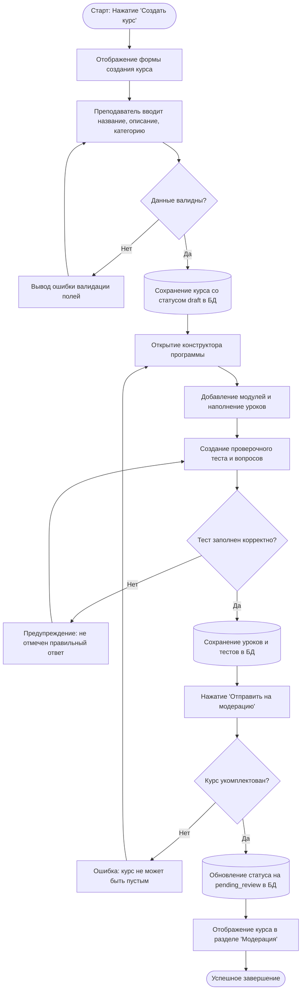
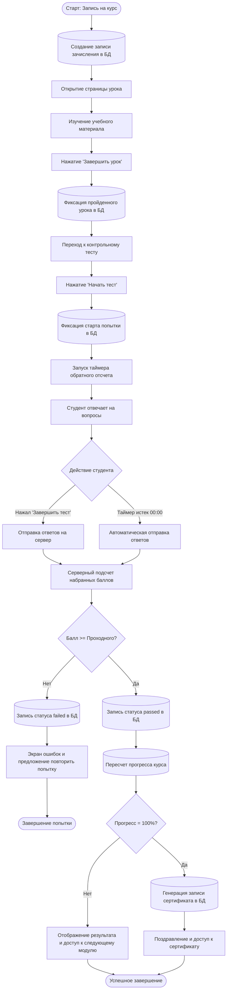
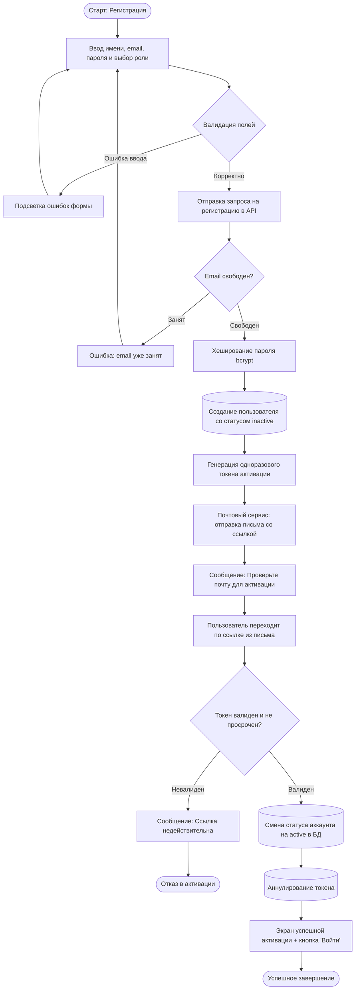

# Сценарии использования

## 1. Введение
Настоящий документ содержит детализированные сценарии выполнения ключевых вариантов использования веб-приложения для организации онлайн-обучения и тестирования. Для каждого сценария определены задействованные акторы и компоненты, предусловия, основной и альтернативные потоки событий, постусловия, а также представлены диаграммы деятельности (Activity Diagrams).

---

## 2. Сценарий 1: Создание курса и отправка на модерацию (Преподаватель)

### 2.1. Паспорт сценария
- **Варианты использования**: ВИ-4.1, ВИ-4.2, ВИ-4.3, ВИ-4.4.
- **Участники**: Преподаватель, Веб-интерфейс (Клиент), Серверная часть (API), База данных.
- **Предусловие**: Преподаватель авторизован в системе и находится в разделе «Мои курсы».
- **Постусловие**: Курс со структурой модулей, уроков и тестом создан в базе данных и переведен в статус `pending_review` (На модерации).

### 2.2. Основной поток выполнения
1. Преподаватель нажимает кнопку «Создать курс» в разделе «Мои курсы».
2. Клиент отображает форму создания курса.
3. Преподаватель вводит название, описание, выбирает категорию, уровень сложности и нажимает «Сохранить».
4. Сервер проверяет заполненность обязательных полей.
5. Сервер создает запись курса в БД со статусом `draft`.
6. Клиент открывает конструктор программы курса.
7. Преподаватель добавляет модуль курса, указывая название и порядковый номер.
8. Преподаватель добавляет в модуль уроки, вводя заголовок и наполняя контент текстом и ссылками.
9. Преподаватель добавляет проверочный тест к модулю, задает проходной балл, лимит времени и банк вопросов с вариантами ответов.
10. Сервер валидирует структуру теста (наличие правильных ответов) и сохраняет данные в БД.
11. Преподаватель нажимает кнопку «Отправить на модерацию».
12. Сервер выполняет финальную валидацию (в курсе есть хотя бы 1 модуль, 1 урок и 1 тест).
13. Сервер обновляет статус курса на `pending_review` в базе данных.
14. Клиент выводит сообщение: «Курс успешно отправлен на модерацию».

### 2.3. Альтернативные потоки
- **А1: Ошибка валидации формы создания курса (шаг 4)**
  - Сервер возвращает код ошибки 400 и список незаполненных обязательных полей.
  - Клиент подсвечивает некорректные поля красным цветом с подсказками.
  - Преподаватель исправляет данные и повторяет отправку.
- **А2: В вопросе теста не указан правильный ответ (шаг 10)**
  - Сервер отклоняет сохранение теста с сообщением: «У каждого вопроса должен быть хотя бы один правильный ответ».
  - Клиент отображает предупреждение на вкладке редактирования вопроса.
  - Преподаватель отмечает правильный вариант и сохраняет тест.
- **А3: Попытка отправить пустой курс на модерацию (шаг 12)**
  - Сервер определяет отсутствие уроков или тестов в курсе.
  - Статус курса остается `draft`.
  - Клиент выводит сообщение: «Для отправки на модерацию курс должен содержать минимум один модуль с уроком и проверочным тестом».

### 2.4. Диаграмма деятельности: Создание и отправка курса

---

## 3. Сценарий 2: Запись на курс, изучение урока и сдача проверочного теста (Студент)

### 3.1. Паспорт сценария
- **Варианты использования**: ВИ-2.3, ВИ-3.1, ВИ-3.2, ВИ-3.3, ВИ-3.4.
- **Участники**: Студент, Веб-интерфейс (Клиент), Серверная часть (API), База данных.
- **Предусловие**: Студент авторизован в системе, курс опубликован.
- **Постусловие**: Прогресс студента обновлен в БД, тест зачтен (или зафиксирована неудачная попытка), при 100% сгенерирован сертификат.

### 3.2. Основной поток выполнения
1. Студент открывает страницу опубликованного курса и нажимает «Записаться на курс».
2. Сервер создает запись в таблице зачислений со статусом `in_progress` и прогрессом `0%`.
3. Курс появляется в разделе студента «Мое обучение».
4. Студент открывает первый урок модуля и изучает материал.
5. Студент нажимает кнопку «Завершить урок».
6. Сервер фиксирует завершение урока в таблице прогресса и пересчитывает общий процент прохождения курса.
7. Клиент разблокирует доступ к контрольному тесту модуля.
8. Студент нажимает «Начать тест».
9. Сервер фиксирует время старта попытки в таблице `test_attempts` и передает вопросы клиенту.
10. Клиент запускает таймер обратного отсчета времени.
11. Студент выбирает ответы на вопросы и нажимает «Завершить тест».
12. Сервер сверяет ответы с эталонными ключами в БД и рассчитывает набранный процент.
13. Набранный балл $\ge$ проходного балла: сервер фиксирует статус попытки `passed`.
14. Сервер пересчитывает общий прогресс студента по курсу.
15. Если итоговый прогресс достиг 100%: сервер генерирует сертификат с уникальным номером.
16. Клиент отображает страницу результатов с набранным баллом, поздравлением и списком правильных/неправильных ответов.

### 3.3. Альтернативные потоки
- **А1: Студент уже записан на этот курс (шаг 2)**
  - Сервер сообщает, что пользователь уже зачислен на данный курс.
  - Клиент сразу перенаправляет студента на текущий изучаемый урок.
- **А2: Истечение времени таймера при тестировании (шаг 11)**
  - Таймер на клиенте достигает 00:00.
  - Клиент автоматически блокирует ввод и отправляет текущие сохраненные ответы на сервер.
  - Процесс проверки продолжается с шага 12.
- **А3: Набранный балл ниже проходного (шаг 13)**
  - Сервер фиксирует статус попытки `failed`.
  - Прогресс по модулю не засчитывается, сертификат не генерируется.
  - Клиент отображает экран результатов с рекомендацией повторить материал урока и кнопкой повторного прохождения.

### 3.4. Диаграмма деятельности: Обучение и тестирование

---

## 4. Сценарий 3: Регистрация и активация аккаунта

### 4.1. Паспорт сценария
- **Варианты использования**: ВИ-1.1, ВИ-1.2, ВИ-1.3.
- **Участники**: Новый пользователь, Веб-интерфейс, Серверная часть (API), Почтовый сервис, База данных.
- **Предусловие**: Пользователь не имеет учетной записи в системе.
- **Постусловие**: Аккаунт создан, активирован и готов к авторизации.

### 4.2. Диаграмма деятельности: Регистрация и активация

