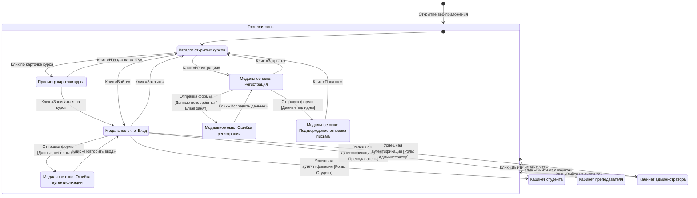
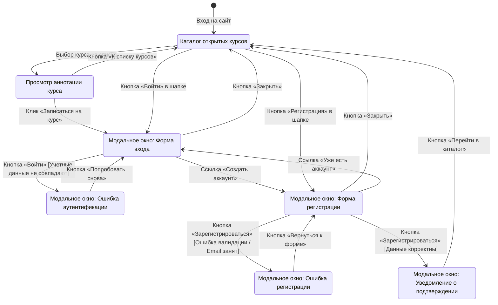
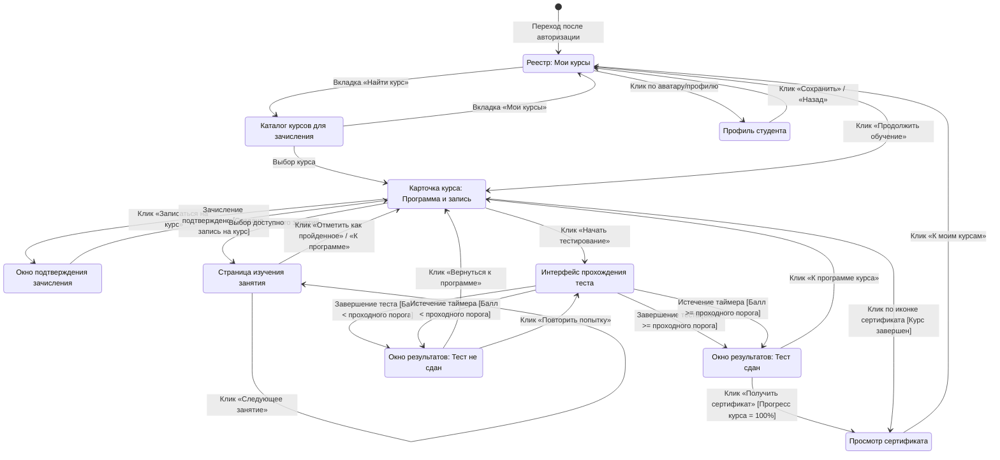
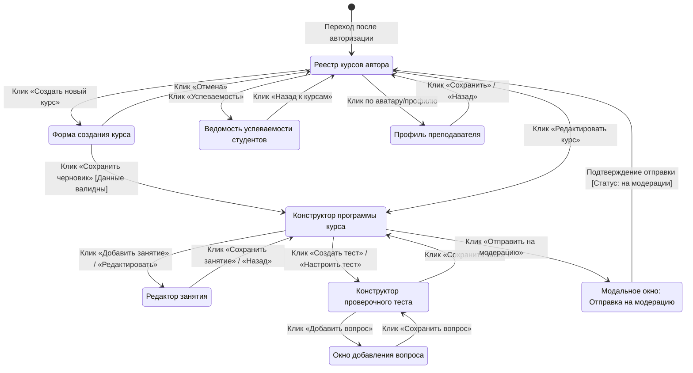
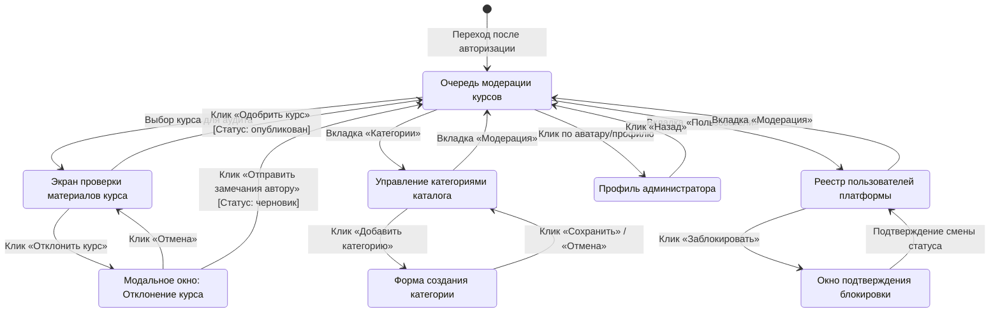

# Навигация по интерфейсу

## 1. Введение
Настоящий документ содержит диаграмму состояний пользовательского интерфейса веб-приложения для организации онлайн-обучения и тестирования, определяющую экраны системы, модальные состояния и логику переходов между ними.

---

## 2. Диаграмма состояний интерфейса верхнего уровня

---

## 3. Декомпозиция состояний интерфейса

### 3.1. Гостевая зона

### 3.2. Кабинет студента

### 3.3. Кабинет преподавателя

### 3.4. Кабинет администратора

---

## 4. Спецификация переходов между состояниями

| Исходное состояние | Событие / Триггер | Сторожевое условие | Результирующее состояние | Действие системы |
|---|---|---|---|---|
| `[*]` | Загрузка веб-приложения | — | `Каталог открытых курсов` | Запрос и рендеринг списка опубликованных курсов |
| `Каталог открытых курсов` | Клик «Войти» | — | `Модальное окно: Форма входа` | Отображение диалогового окна аутентификации |
| `Модальное окно: Форма входа` | Клик «Войти» | Учётные данные неверны (401) | `Модальное окно: Ошибка аутентификации` | Вывод сообщения о неверном логине/пароле |
| `Модальное окно: Форма входа` | Клик «Войти» | Учётные данные верны, роль: Студент | `Реестр: Мои курсы` | Создание сессии, перенаправление в кабинет студента |
| `Модальное окно: Форма входа` | Клик «Войти» | Учётные данные верны, роль: Преподаватель | `Реестр курсов автора` | Создание сессии, перенаправление в кабинет преподавателя |
| `Модальное окно: Форма входа` | Клик «Войти» | Учётные данные верны, роль: Администратор | `Очередь модерации курсов` | Создание сессии, перенаправление в кабинет администратора |
| `Каталог открытых курсов` | Клик «Регистрация» | — | `Модальное окно: Форма регистрации` | Отображение диалогового окна с полями регистрации |
| `Модальное окно: Форма регистрации` | Клик «Зарегистрироваться» | Ошибки валидации / Email занят | `Модальное окно: Ошибка регистрации` | Подсветка полей с ошибками |
| `Модальное окно: Форма регистрации` | Клик «Зарегистрироваться» | Данные валидны, email уникален | `Модальное окно: Уведомление о подтверждении` | Создание неактивной записи, постановка письма в очередь |
| `Кабинет студента` | Клик «Выйти из аккаунта» | — | `Каталог открытых курсов` | Инвалидация токенов сессии, сброс контекста |
| `Карточка курса: Программа и запись` | Клик «Записаться на курс» | Запись отсутствует | `Карточка курса: Программа и запись` | Создание записи на курс (прогресс 0%), открытие доступа к урокам |
| `Страница изучения занятия` | Клик «Отметить как пройденное» | Занятие ранее не завершено | `Страница изучения занятия` | Сохранение отметки, пересчет процента прогресса курса |
| `Интерфейс прохождения теста` | Клик «Завершить тест» / Таймер 00:00 | Балл $\ge$ проходного балла | `Окно результатов: Тест сдан` | Фиксация успешной попытки, пересчет прогресса курса |
| `Интерфейс прохождения теста` | Клик «Завершить тест» / Таймер 00:00 | Балл < проходного балла | `Окно результатов: Тест не сдан` | Фиксация неуспешной попытки, вывод протокола ошибок |
| `Окно результатов: Тест сдан` | Клик «Получить сертификат» | Прогресс курса = 100% | `Просмотр сертификата` | Генерация и отображение бланка сертификата |
| `Форма создания курса` | Клик «Сохранить черновик» | Поля заполнены корректно | `Конструктор программы курса` | Создание записи курса со статусом «черновик» |
| `Конструктор программы курса` | Клик «Отправить на модерацию» | В курсе есть $\ge 1$ занятия и теста | `Реестр курсов автора` | Перевод курса в статус «на модерации» |
| `Экран проверки материалов курса` | Клик «Одобрить курс» | — | `Очередь модерации курсов` | Перевод курса в статус «опубликован» |
| `Экран проверки материалов курса` | Клик «Отправить замечания» | Замечания заполнены | `Очередь модерации курсов` | Возврат статуса курса в «черновик», отправка замечаний автору |

---

## 5. Матрица трассировки вариантов использования к экранным состояниям

| Идентификатор прецедента | Название прецедента | Реализующие экранные состояния |
|---|---|---|
| ВИ-1.1 | Регистрация | `Модальное окно: Форма регистрации`, `Модальное окно: Ошибка регистрации`, `Модальное окно: Уведомление о подтверждении` |
| ВИ-1.2 | Аутентификация | `Модальное окно: Форма входа`, `Модальное окно: Ошибка аутентификации` |
| ВИ-1.3 | Выход из системы | Переход «Выйти из аккаунта» из шапки любого авторизованного кабинета в `Каталог открытых курсов` |
| ВИ-2.1 | Просмотр каталога курсов | `Каталог открытых курсов`, `Каталог курсов для зачисления` |
| ВИ-2.2 | Поиск и фильтрация курсов | `Каталог открытых курсов` (блоки фильтрации по категориям и строке поиска) |
| ВИ-2.3 | Запись на курс | `Просмотр карточки курса`, `Карточка курса: Программа и запись` |
| ВИ-3.1 | Просмотр материалов курса | `Карточка курса: Программа и запись`, `Страница изучения занятия` |
| ВИ-3.2 | Изучение занятия и отметка о завершении | `Страница изучения занятия` |
| ВИ-3.3 | Прохождение проверочного теста | `Интерфейс прохождения теста`, `Окно результатов: Тест сдан`, `Окно результатов: Тест не сдан` |
| ВИ-3.4 | Получение сертификата | `Просмотр сертификата` |
| ВИ-4.1 | Создание курса | `Форма создания курса` |
| ВИ-4.2 | Управление программой курса | `Конструктор программы курса`, `Редактор занятия` |
| ВИ-4.3 | Создание и настройка проверочного теста | `Конструктор проверочного теста`, `Окно добавления вопроса` |
| ВИ-4.4 | Контроль успеваемости студентов | `Ведомость успеваемости студентов` |
| ВИ-5.1 | Модерация курсов | `Очередь модерации курсов`, `Экран проверки материалов курса`, `Модальное окно: Отклонение курса` |
| ВИ-5.2 | Управление категориями каталога | `Управление категориями каталога`, `Форма создания категории` |
